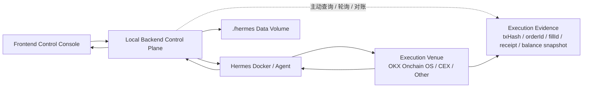

# Hermes + Execution Venue Control Architecture

Date: 2026-04-26

## Goal

Build a local frontend trading control system that can start and configure Hermes in Docker, manage the local `./hermes` data volume, communicate with Hermes through its API server, and let Hermes execute through pluggable execution venues such as OKX Onchain OS and future CEX integrations.

The design keeps the browser as a control surface only. Docker control, credential handling, file writes, audit logging, and risk checks stay in the local backend.

## Source Constraints

Hermes Docker stores all user data in a host directory mounted at `/opt/data`. The official persistent gateway shape is:

```bash
docker run -d \
  --name hermes \
  --restart unless-stopped \
  -v ./hermes:/opt/data \
  -p 8642:8642 \
  nousresearch/hermes-agent gateway run
```

Hermes API Server is OpenAI-compatible. The backend should use:

- `GET /health`
- `GET /v1/models`
- `POST /v1/chat/completions`
- `POST /v1/responses`
- Runs/SSE APIs later for richer progress streaming

OKX Onchain OS is treated as an execution venue, not as a direct callback source to the local backend.

References:

- https://hermes-agent.nousresearch.com/docs/user-guide/docker
- https://hermes-agent.nousresearch.com/docs/user-guide/features/api-server
- https://web3.okx.com/zh-hans/onchainos/dev-docs/home/what-is-onchainos

## Selected Architecture



## Module Responsibilities

### Frontend Control Console

- Shows Hermes runtime status, trading state, venue status, execution records, logs, and evidence.
- Sends commands to the local backend: start Hermes, save configuration, probe Hermes, start/pause trading, approve/reject high-risk actions.
- Does not store Hermes API keys, OKX keys, wallet secrets, or venue secrets.

### Local Backend Control Plane

- Starts, stops, inspects, and probes the `hermes` Docker container.
- Owns the `./hermes` data volume from the host side.
- Reads and writes:
  - `./hermes/.env`
  - `./hermes/config.yaml`
  - `./hermes/SOUL.md`
  - `./hermes/skills/`
- Talks to Hermes API Server on `http://127.0.0.1:8642`.
- Stores audit records and normalized execution state.
- Applies local risk gates before allowing a trading action to become executable.
- Polls or reconciles evidence after execution.

### Hermes Docker / Agent

- Runs as the agent brain and tool orchestration layer.
- Uses the mounted `./hermes` directory as the single source of truth.
- Receives strategy prompts and execution tasks from the backend.
- Calls OKX Onchain OS Skills/MCP or later venue adapters.
- Returns structured decisions, tool progress, final execution summaries, and evidence references to the backend.

### Execution Venue

The first venue is OKX Onchain OS. Future venues may include CEX APIs, broker APIs, or other DEX aggregators.

Venues are not modeled as direct webhook producers for the backend. The backend learns about results through Hermes responses and active reconciliation.

### Execution Evidence

Execution evidence is the generic settlement layer. It is intentionally not chain-specific.

```ts
type ExecutionVenue = "okx_onchain_os" | "cex" | "dex" | "broker" | "manual";

type ExecutionEvidence =
  | {
      kind: "onchain";
      txHash: string;
      chainIndex: string;
      blockNumber?: number;
      confirmations?: number;
      status: "submitted" | "confirmed" | "failed";
    }
  | {
      kind: "cex_order";
      orderId: string;
      clientOrderId?: string;
      fillId?: string;
      status: "submitted" | "filled" | "partial" | "cancelled" | "failed";
    }
  | {
      kind: "receipt";
      receiptId: string;
      status: "pending" | "settled" | "failed";
    }
  | {
      kind: "balance_snapshot";
      venue: ExecutionVenue;
      accountId?: string;
      capturedAt: string;
      balances: Array<{ asset: string; amount: string; usdValue?: string }>;
    };
```

## Data Flow

### Hermes Setup Flow

1. Frontend calls backend `POST /api/hermes/setup`.
2. Backend ensures `./hermes` exists.
3. Backend writes or updates API server env values in `./hermes/.env`.
4. Backend starts or reuses Docker container `hermes`.
5. Backend probes `/health` and `/v1/models`.
6. Frontend shows runtime status.

### Configuration Flow

1. Frontend edits SOUL, runtime settings, risk limits, and venue settings.
2. Backend validates the payload.
3. Backend writes SOUL/config/env files.
4. Backend can restart or hot-probe Hermes when needed.
5. Audit log records what changed without exposing secrets.

### Trading Decision Flow

1. Backend sends market context and strategy context to Hermes.
2. Hermes reasons and calls venue tools.
3. Venue returns execution result to Hermes.
4. Hermes returns a structured summary to backend.
5. Backend normalizes the result into `ExecutionEvidence`.
6. Backend polls/reconciles evidence if needed.
7. Frontend displays decision, execution state, and settlement evidence.

## Risk Gates

The backend owns enforcement even when Hermes owns reasoning.

Minimum gates:

- Trading mode: `paper` / `live`
- Venue allowlist
- Chain/network allowlist
- Token allowlist
- Max single trade USD
- Max position percent
- Daily loss limit
- Slippage limit
- Manual approval threshold
- Kill switch

High-risk live actions must require explicit approval before execution, unless the user later opts into full autonomy with bounded limits.

## Error Handling

- Docker unavailable: show backend runtime error and remediation.
- Port conflict: inspect existing `hermes` container and reuse if it mounts the same data directory.
- Hermes unhealthy: show gateway logs and keep frontend controls disabled.
- API auth failure: rotate/update `API_SERVER_KEY` in `.env`, then restart/probe.
- Venue failure: record failed execution evidence with raw error summary.
- Settlement unknown: keep evidence status as pending and continue reconciliation.

## Testing Strategy

Automated tests:

- Unit test env merge preserves existing secrets.
- Unit test Docker command shape matches official Hermes gateway mode.
- Unit test evidence normalization for on-chain and CEX order cases.
- API route tests for setup, config save, health probe, and risk gate rejection.

Integration tests:

- Start local backend.
- Start/reuse `hermes` Docker container.
- Probe `/health` and `/v1/models`.
- Send a Hermes chat/responses probe.
- Run a paper trading cycle and assert execution evidence is recorded.

Browser tests:

- Settings: start Hermes, save SOUL, test API, probe chat.
- Dashboard: start/pause/kill switch state changes.
- Executions: evidence appears with venue-specific details.

## Open Decisions

- Whether the first implementation uses Hermes `chat/completions` or `responses` as the main command API. Recommendation: use `responses` for multi-turn state, keep chat completions for simple probes.
- Whether OKX is integrated first through Skills/MCP or Open API. Recommendation: start with Skills/MCP for Agent-native behavior, then add backend Open API adapters only for reconciliation and read-only checks.
- Whether live trading requires per-trade approval by default. Recommendation: yes.
